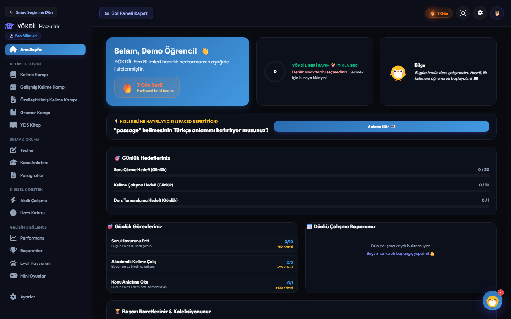
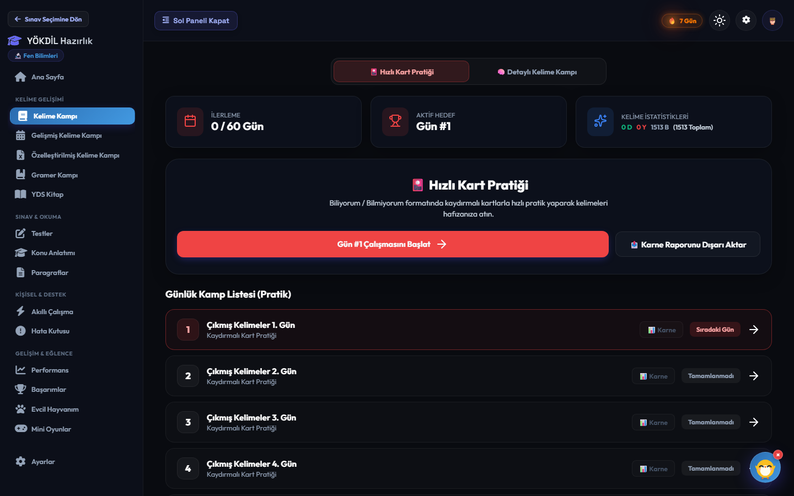
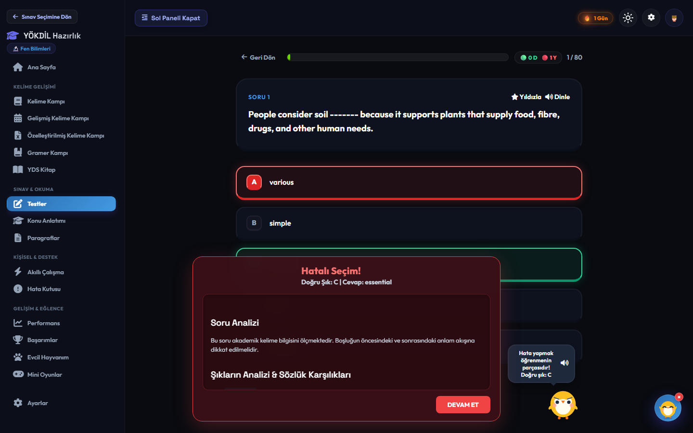
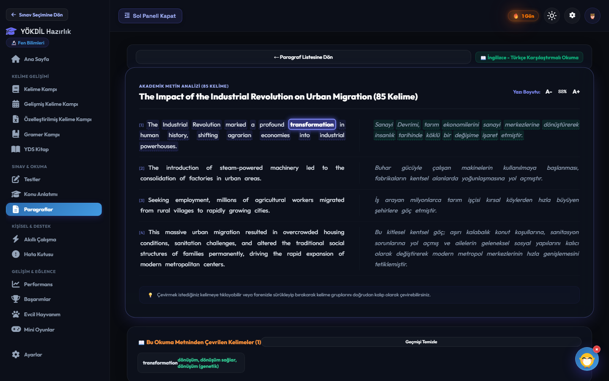
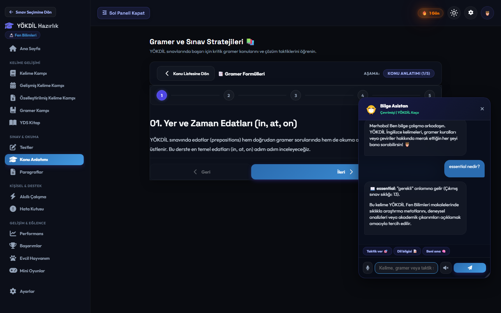
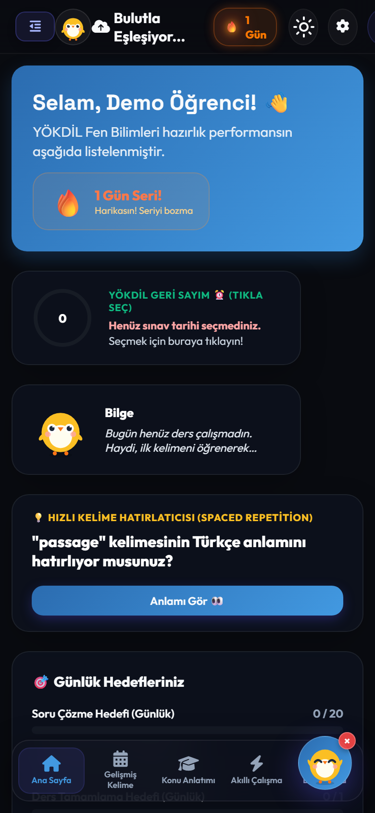

# 🎓 YÖKDİL & YDS Akademik İngilizce Hazırlık Platformu

Bu proje; **YÖKDİL** (Fen Bilimleri, Sosyal Bilimler, Sağlık Bilimleri) ve **YDS** sınavlarına hazırlanan öğrenciler için geliştirilmiş, kapsamlı bir akademik İngilizce öğrenim ve hazırlık platformudur. Uygulama; masaüstü (**Web Gui**) ve mobil (**Mobil Gui**) için optimize edilmiş iki ayrı React 19 arayüzü, yerel JSON/sözlük veri setleri, Node.js/Express API sunucusu (`Vercel Serverless` uyumlu) ve Bilge Çalışma Arkadaşı bileşenleriyle donatılmıştır.

---

## 📸 Arayüz Ekran Görüntüleri & Tanıtım Videosu

* **Demo Videosu:** [screenshots/demo_video.webm](screenshots/demo_video.webm)

| Panel & Günlük Hedefler | 60 Günlük Kelime Kampı | Sınav Soru Analizi & Hata Açıklaması |
|:---:|:---:|:---:|
|  |  |  |

| Paralel Okuma & Kelime Çevirisi | Konu Anlatımı & Bilge Asistan | Mobil PWA Görünümü (`390x844`) |
|:---:|:---:|:---:|
|  |  |  |

---

## 🎯 Örnek Sonuçlar & Girdi-Çıktı Kıyaslaması (Proof of Work)

| Senaryo | Girdi (Input) | İşlem / API Süreci | Çıktı (Output) |
|:---|:---|:---|:---|
| **Çıkmış Sınav Hata Analizi (`2018-ilkbahar` #1)** | Kullanıcı cevabı: `A) various` | `GET /api/fen/exams/2018-ilkbahar/explain/1` (`200 OK`) | Doğru şık `C) essential`, tüm şıkların sözlük karşılıkları ve çözüm yolu paneli |
| **Paralel Okuma & Kelime Tıklama** | İngilizce paragraftan `"transformation"` seçimi | Kök indirgeme + yerel sözlük (`/api/fen/dictionary`) eşleştirmesi | `"dönüşüm, dönüşüm sağlar, dönüşüm (genetik)"` çevirisi ve Türkçe eşleşme vurgusu |
| **Bilge Asistan NLP Sorgusu** | `"essential nedir?"` | `POST /api/fen/chat` sözlük & frekans motoru (`200 OK`) | `essential: "gerekli" anlamına gelir (Çıkmış sınav sıklığı: 13)` |

---

## 🌟 Temel Özellikler

### 1. 📅 Katmanlı Akademik Kamplar
* **Kelime Kampı (`kelime_kampi`):** Sınavlarda en sık çıkan kelimelerin telaffuzları, Türkçe karşılıkları ve interaktif kelime kartları.
* **Gelişmiş Kelime Kampı (`gelismis_kelime_kampi`):** 1.504 kelimelik havuz, günlere bölünmüş ilerleme ve karne dışa aktarma.
* **Özel Kelime Kampı:** SheetJS (`xlsx`) şablonu üzerinden özel kelime listeleri yükleyerek çalışma.
* **Gramer Kampı (`gramer_kampi`) & Konu Anlatımı (`konu_anlatimi`):** 13 ünitelik anlatım ve pekiştirme egzersizleri.
* **YDS Kitap Alıştırmaları (`yds_kitap`):** 62 günlük okuma ve kelime odaklı çalışma planı.

### 2. 📝 Sınav & Değerlendirme Modülleri
* **Çıkmış YÖKDİL Sınavları (`2018-ilkbahar` – `2026-mart`):** 9 tam sınavlık soru arşivi, anlık doğru/yanlış değerlendirme ve yapısal çözüm açıklaması.
* **Hata Kutusu (Mistake Inbox):** Sınav, kamp ve okuma parçalarındaki yanlışları toplayıp hata temizleme maratonuyla eritme.

### 3. 🔍 Paralel Okuma & Yerel Çeviri Popover'ı (`ParagraphsSection`)
* İngilizce-Türkçe paralel okuma parçalarında tıklanan veya seçilen kelime/öbekler için yerel kök/sözlük eşleştirme (`1.504` kelimelik sözlük + MyMemory API yedeği).

### 4. 🦉 Bilge Çalışma Arkadaşı & Evcil Hayvan Sistemi
* Çalışma durumuna göre tepki veren Bilge Baykuş maskotu ve yerel NLP destekli sohbet koçu.
* Gamification rozetleri (`achievements.json`), günlük seri takibi ve PDF/DOCX/XLSX karne çıktıları.

---

## 🛠️ Teknoloji Yığını (Tech Stack)

### Frontend (Arayüz Katmanı)
* **React 19 & Vite 8:** Hızlı derleme ve masaüstü (`Web Gui`) + mobil (`Mobil Gui`) bileşen mimarisi.
* **Lucide React & FontAwesome:** Modern karanlık tema (glassmorphism) ve 20+ renk/oda teması desteği.
* **jsPDF, html2pdf.js, pdfjs-dist, xlsx:** İstemci tarafı PDF/Excel karne dışa aktarma ve veri işleme.

### Backend & API (Servis Katmanı)
* **Node.js & Express (`Web Gui/backend/server.js`):** Sınav, sözlük, frekans, gramer açıklaması, çeviri, NLP sohbet ve JWT kullanıcı senkronizasyon servisleri.
* **Vercel Serverless Functions (`api/server.js`):** Vercel platformunda sunucusuz API yayını.
* **Python (`main.py` & `backend/scripts`):** Tüm geliştirme sunucularını tek komutla başlatma ve sınav verisi ayrıştırma araçları.

---

## 🛠️ Test & Geliştirme Raporu (Doğrulanmış Güncellemeler)
1. **Eksik Dataset Yönlendirmeleri Giderildi:** `Mobil Gui` içinde eksik `sosyal`/`saglik` importları `fen` veri seti yedeğine bağlanarak `vite build` hatası çözüldü; `ParagraphsSection` ve `SmartStudySection` dinamik yüklemelerine `fen` fallback eklendi.
2. **Backend API Rotaları Güncellendi (`Web Gui/backend/server.js`):** `/api/:category/exams`, `/api/lectures`, `/api/lectures/:id/exercises`, `/api/passages`, `/api/:category/vocabulary` ve `/api/:category/exams/:examId/explain/:qNumber` uç noktaları güncel `Dataset/yokdil/fen/*` dosya dizinleri ve `question.correct_option` yapısıyla uyumlu hale getirilerek `200 OK` döndürecek şekilde onarıldı.
3. **10 MB JSON Limiti (`413` Fix):** 1.504 kelimelik defter eşitlemesi sırasında `/api/user/sync` ucunda oluşan `413 Payload Too Large` hatası `express.json({ limit: '10mb' })` ile giderildi.
4. **Frontend Fetch, AuthModal & Mobil Proxy İyileştirmeleri:** Fetch çağrılarına `res.ok` ve dizi kontrolleri eklendi; `AuthModal` hızlı giriş formu `{ username }` gövdesiyle `/api/auth/guest` ucuna bağlandı; `TranslationPopover.jsx` içindeki `justifySpace` yazım hatası `justifyContent` olarak düzeltildi; `Mobil Gui` için `--host` ve `/dataset` proxy tanımlandı.

---

## 📁 Proje Klasör Yapısı

```text
├── api/                   # Vercel Serverless API giriş noktası
├── Dataset/yokdil/        # Başarımlar, 9 çıkmış sınav, sözlük, 60 gün kamp & 13 konu anlatımı JSON/MD veri seti
├── Mobil Gui/             # Mobil cihazlar için optimize edilmiş React 19 + Vite 8 uygulaması (Port 5174)
├── Web Gui/               # Masaüstü web uygulaması (Port 5173)
│   ├── backend/server.js  # Express API sunucusu (Port 5000)
│   └── src/               # Özellik modülleri (quiz, camp, vocabulary, paragraphs, mistakes, lectures)
├── screenshots/           # Doğrulanmış arayüz ekran görüntüleri ve demo videosu
├── main.py                # Express, Web Gui ve Mobil Gui'yi eşzamanlı başlatan Python orkestratörü
├── vercel.json            # Vercel dağıtım ve yönlendirme yapılandırması
└── README.md              # Bu dokümantasyon dosyası
```

---

## 🚀 Başlangıç ve Çalıştırma

### 1. Tek Komutla Başlangıç (Tavsiye Edilen)
Proje kök dizininde `python main.py` komutunu çalıştırarak Express (`5000`), Web Gui (`5173`) ve Mobil Gui (`5174`) sunucularını otomatik bağımlılık kurulumuyla başlatabilirsiniz:

```bash
python main.py
```

### 2. Manuel Başlangıç
```bash
# A. Backend (Port 5000)
cd "Web Gui/backend" && npm install && node server.js

# B. Web Gui (Port 5173)
cd "Web Gui" && npm install && npm run dev

# C. Mobil Gui (Port 5174)
cd "Mobil Gui" && npm install && npm run dev -- --port 5174
```

---

## ⚖️ Yasal Uyarı & Telif Hakkı Bildirimi (Disclaimer)

> **Önemli Bilgilendirme:** Bu proje ve kaynak kodları **tamamen kişisel eğitim, akademik yabancı dil gelişimini destekleme ve açık kaynaklı yazılım geliştirme** amacıyla hazırlanmıştır.
> - Platform içerisindeki hiçbir modül, kelime havuzu veya sınav içeriği **kesinlikle ticari bir nitelik taşımamakta**, herhangi bir ücretli abonelik, gelir veya ticari kazanç amacı gütmemektedir.
> - Sınav isimleri, telifli terimler ve soru formatları **ÖSYM (Ölçme, Seçme ve Yerleştirme Merkezi)** ve ilgili resmi sınav otoritelerine aittir.
